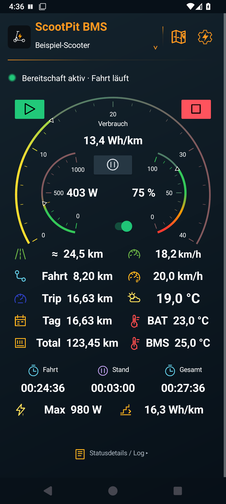
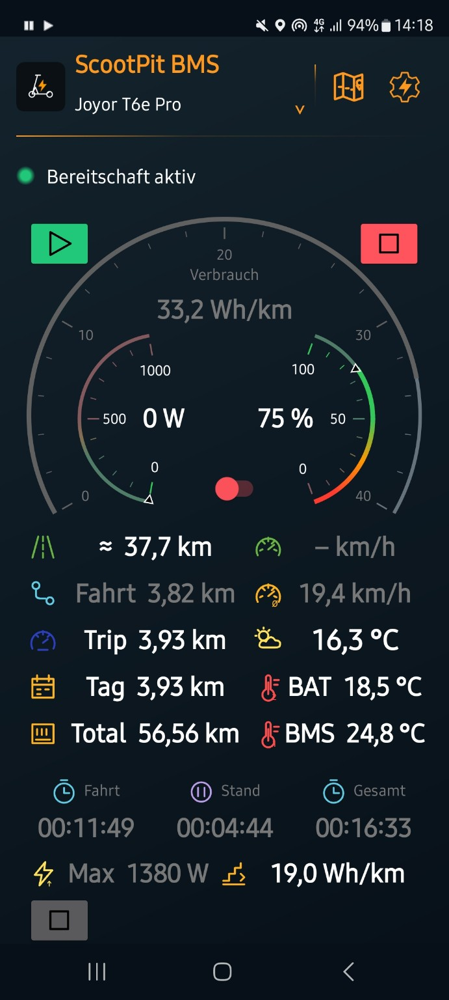
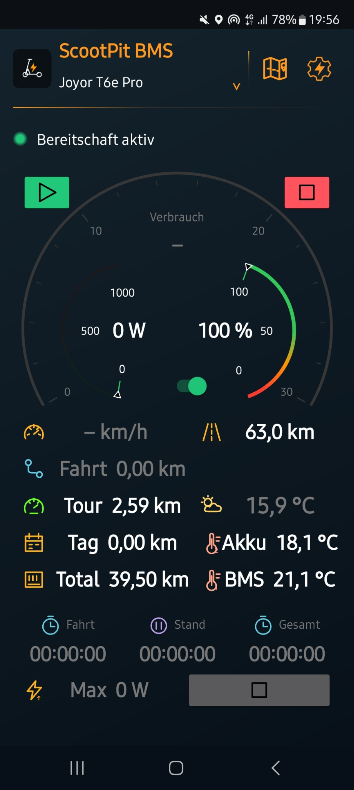

# ScootPit BMS – Joyor T6E Pro App

**Android-Cockpit und automatisches Fahrtenbuch für den Joyor T6E Pro mit kompatiblem JBD-BMS.**

ScootPit BMS wurde mit dem **Joyor T6E Pro und dem JBD SP14S004** entwickelt. Die App zeigt BMS-, Akku- und Fahrtdaten live an und zeichnet Scooter-Fahrten automatisch auf – auch bei gesperrtem Handy. [Kompatibilität, Einrichtung und Download für den Joyor T6E Pro](docs/joyor-t6e-app.md).

**Automatisches Fahrtenbuch für deinen E-Scooter – auch mit dem Handy in der Hosentasche.**

**ScootPit – für alle, die ihren Roller überwachen wollen, ohne selbst überwacht zu werden.**

**Version 1.6.13 · [APK herunterladen](https://github.com/Tim-Gurke/ScootPit-BMS/releases/latest)**

**[Bedienungsanleitung mit Bildern: Was finde ich wo und wie funktioniert es?](docs/anleitung.md)**

Das Highlight ist die Automatik: **Bereitschaft einschalten, zum Scooter gehen und losfahren.** ScootPit erkennt ein gespeichertes Bluetooth-BMS in Reichweite, wählt das zugehörige Scooter-Profil und verbindet sich bei ausreichend stabilem Empfang automatisch. Die Fahrtaufzeichnung startet, sobald die eingestellten Bedingungen für die Stromentnahme erfüllt sind. Die Annäherung allein startet noch keine Fahrt.

Die Aufzeichnung läuft auch mit ausgeschaltetem Bildschirm und gesperrtem Handy. Beim Ausrollen wird GPS weiter ausgewertet: **0 W allein pausiert die Fahrt nicht**, auch eine längere Bergabfahrt bleibt bei erkennbarer GPS-Fahrgeschwindigkeit in der Aufzeichnung. Nach **45 Sekunden zuverlässig erkanntem Stillstand** oder **15 Sekunden langsamer Bewegung ohne Motorlast** pausiert sie; Fußwege werden nicht als Fahrstrecke gezählt. Die BMS-Verbindung bleibt bestehen. Eine Fortsetzung erfordert passende GPS-Fahrgeschwindigkeit und anhaltende Motorlast. Nach **10 Minuten automatischer Pause** wird sie rückwirkend zum Pausenbeginn abgeschlossen. Eine manuelle Pause hält dieselbe Fahrt bis zu 12 Stunden offen und setzt bei bestätigter Weiterfahrt automatisch fort; die Wegfahrsperre muss dafür nicht aktiviert werden. Ist sie aktiv, muss vor dem Losfahren der Lastausgang wieder eingeschaltet sein. Geht die Verbindung während einer automatischen Pause verloren, sucht die App weiter und wartet standardmäßig bis 2 Minuten nach Pausenbeginn auf eine Wiederverbindung. Die Zeiten sind je Scooter einstellbar. GPS-Ausfall allein gilt nicht als Stillstand.

Mehrere gespeicherte Scooter? Die App prüft erreichbare BMS nacheinander und übernimmt das passende Profil. Während einer laufenden Fahrt bleibt die Zuordnung fest. Unbekannte BMS werden nicht ungefragt übernommen; jedes Gerät wird bei der Einrichtung einmal seinem Profil zugeordnet.

Am Lenker wird ScootPit zum **persönlichen Energie-Cockpit**: Der Verbrauch einer frei wählbaren Strecke und die aktuelle elektrische Leistung stehen im Mittelpunkt. Akku, Restreichweite, Kilometer und Temperaturen ergänzen die Übersicht; GPS-Geschwindigkeit bleibt als kleinere Anzeige verfügbar.

### Cockpitansicht

<em>Version 1.6.9 im Android-Emulator mit gekennzeichneten Beispielwerten. Die neue Anordnung und Werteinstellungen gelten auch für das helle Design. Verbrauch: letzte 300 m, Skala bis 40; Durchschnittsgeschwindigkeit: aktuelle Fahrt; Durchschnittsverbrauch: ab Reset.</em>

### BMS-Lastausgang ausgeschaltet

<em>Der Statushinweis „BMS-Lastausgang aus – bitte einschalten“ wird in 1.6.6 ergänzt.</em>

### Hauptansicht · Bereitschaft aktiv

<em>Bereitschaft ist aktiv; die Fahrtaufzeichnung hat noch nicht begonnen. Eine Ansicht während der Fahrt folgt.</em>

### Hauptansicht · Fahrt läuft

<em>Vorhandene Fahrtansicht · Samsung Galaxy S20 FE 5G · Android 13.</em>

### Weitere Ansichten

<em>Dunkles Cockpit im Hochformat · Samsung Galaxy S20 FE 5G · Android 13.</em>

<em>Helles Design im Hochformat · Samsung Galaxy S10 · ArtisanROM Quant 3.1.1 (Android 16).</em>

### Querformat

<em>Dunkles Design im Querformat · Samsung Galaxy S20 FE 5G · Android 13.</em>

<em>Helles Design im Querformat · Samsung Galaxy S10 · ArtisanROM Quant 3.1.1 (Android 16).</em>

## Was bringt dir ScootPit?

- **Automatisches Tracking:** Fahrtstart und Fahrtende erkennen, Fahr- und Standzeit erfassen, auch mit gesperrtem Handy.
- **Live-Werte im Blick:** GPS-Tacho, Akkustand, Spannung, Strom, Leistung, Energie, Temperaturen und verfügbare Zusatzdaten des BMS.
- **Drei Kilometerzähler:** Gesamtkilometer, Tageskilometer mit täglichem Neustart und ein manuell zurücksetzbarer Tourenzähler – getrennt je Scooter.
- **Fahrtenbuch mit Karte:** Fahrten der letzten 7 oder 30 Tage oder das ganze Fahrtenbuch ansehen, Route mit Start und Ziel anzeigen, zoomen, verschieben, GPX/CSV teilen und einzelne Fahrten oder den kompletten Bestand aus einem Ordner importieren.
- **Auswählbare Statistiken:** Per Häkchen Werte und Diagramme wählen. Geschwindigkeit, Leistung und GPS-Höhe im Zeitverlauf; Zeitraumübersicht, Tagesstrecken und Vergleich einzelner Fahrten.
- **Eigenes Cockpit:** Feines Raster mit 24 Spalten, überlappende Kacheln mit wählbarer Ebene, transparente Hintergründe, einzeln einstellbare Rahmen und Ecken. Zahl/Balken/Rundinstrument wählen, Kreisbogen und Drehwinkel stufenlos anpassen, Messwerte bleiben waagerecht. Skalen und Balken können je Kachel einen frei gefärbten Zwei- oder Dreifarbenverlauf erhalten; die Skalenrichtung lässt sich umkehren. Neue Installationen starten mit dem gespeicherten ScootPit-Design. Farben, Schrift und Einheitenposition lassen sich anpassen. Eigene Bild- und Freitextkacheln sowie getrennte Hoch-/Querformatlayouts.
- **Restreichweite einschätzen:** Akkureserve und Verbrauch berücksichtigen; aktuelle Fahrtdaten und passende Verbrauchshistorie verbessern die Schätzung. Startwert: 20 Wh/km.
- **Samsung-Routinen nutzen:** Editierbare Fahrtstart-/Fahrtende-Nachrichten können eingerichtete Routinen zum Umschalten des Energiesparmodus auslösen. Die App richtet die Routinen nicht selbst ein.
- **Daten behalten:** Fahrten und Einstellungen lokal speichern, zusätzliche Sicherungsordner auswählen. Keine Anmeldung erforderlich.

## Fahrtenbuch in Bildern

<em>Die Karte zeigt die aufgezeichnete Route mit grünem Start und rotem Ziel. Sichtbare OpenStreetMap-Kartenausschnitte werden bei Bedarf online geladen.</em>

<em>Die Einzelstatistik fasst Strecke, Fahr- und Standzeit, Energieverbrauch, Leistung sowie Temperaturwerte zusammen.</em>

<em>Im Fahrtenbuch kannst du einen Zeitraum wählen und den gesamten Scooter-Fahrtenordner oder einzelne CSV-/GPX-Fahrten importieren.</em>

## Neu in 1.6.13

**Verbrauch ab Reset nach Fahrtpausen:** Ausgeschlossene Pausen erzeugen beim Verlust der BMS-Verbindung keine künstliche Energielücke mehr. Vorhandene Zähler bleiben erhalten. Bereits unvollständige Verbrauchssummen erscheinen mit **≈** als erfasste Energie je aufgezeichneter Strecke; fehlende Energie wird nicht ergänzt. [Durchschnittswerte und Grenzen](docs/cockpit.md#durchschnittswerte-bei-fahrtpausen-ab-1613).

**Lokale Kopplung mit Watt’n’Pit:** Auf demselben Handy kann die offizielle Watt’n’Pit-App aktuelle BMS-Grunddaten über ScootPit beziehen. Die Apps stimmen ihre Bluetooth-Verbindung ab; ScootPit erhält Vorrang für die Fahrtaufzeichnung. GPS-Daten und Fahrtrouten werden dabei nicht weitergegeben. Die Kopplung benötigt passende Versionen beider Apps und dasselbe ausgewählte BMS. [Einrichtung und Praxistest](docs/watt-n-pit.md).

Die installierte Versionsnummer steht jetzt direkt neben dem Appnamen im Appkopf. Am Ende der Einstellungen stehen zusätzlich Appversion und Copyright-Hinweis. Die BMS-Sperrfunktion bleibt bei der bisherigen Prüfung geringer Stromaufnahme; sie erkennt einen eingeschalteten Roller nicht zuverlässig. Der echte Bluetooth-Übergang und Pause/Fortsetzen müssen am jeweiligen Roller geprüft werden.

## Neu in 1.6.12

**Sperren ohne Anlernen:** Die gelernte Standstrom-Referenz ist vollständig aus der Freigabe entfernt. Stattdessen prüft ScootPit direkt, ob mindestens fünf Sekunden geringe Stromaufnahme unter 0,15 A vorliegt; die Messauflösung wird berücksichtigt. Eine vorherige Fahrt und GPS-Empfang zum Lernen sind nicht erforderlich. Im Cockpit steht der aktuelle Sperrgrund; ein gescheiterter Versuch zeigt weiterhin einen eigenen Dialog. [Sperrfunktion bedienen](docs/anleitung.md#11-bms-lastausgang-und-optionale-wegfahrsperre).

## Neu in 1.6.11

1.6.11 korrigierte Restwerte beim Lernen und ergänzte einen eigenen Dialog für gescheiterte Schaltversuche. Die damals weiterhin erforderliche Referenz entfällt ab 1.6.12 vollständig. [Aktuelle Sperrfunktion](docs/anleitung.md#11-bms-lastausgang-und-optionale-wegfahrsperre).

## Neu in 1.6.10

Neue Fahrten verwenden **Höhe über dem mittleren Meeresspiegel (MSL)**. Die standortabhängige GPS-Höhenkorrektur funktioniert offline ab Android 8; Cockpit, Höhendiagramm und Export nutzen denselben Bezug. CSV bewahrt zusätzlich die ursprüngliche Ellipsoid-Höhe. Alte Fahrtdateien bleiben erhalten und erhalten im Diagramm einen erkennbaren Hinweis auf ihren bisherigen Höhenbezug. [Höhenangaben und Grenzen](docs/fahrtenbuch.md#höhe-und-höhenbezug-ab-1610).

Unter **Einstellungen → Verbindungsdiagnose** lassen sich Suchpausen, Empfang und Verbindungsphasen nachvollziehen. Der lokale Bericht enthält keine Geräteadresse oder Fahrtroute und kann bewusst kopiert oder geteilt werden. [Diagnose verwenden](docs/verbindungsdiagnose.md) · [Bisherige Gerätetests und Praxismeldungen](docs/geraetetests.md).

## Neu in 1.6.9

Die neue Cockpit-Vorlage übernimmt die bereitgestellte Anordnung und Werte: Fahrtaktionen über das Pausezeichen zwischen den Instrumenten, Durchschnittsverbrauch unten rechts und dessen Bezugsbereich **Ab Reset**. Die Verbrauchsanzeige nutzt **300 m** und die große Skala endet bei **40**. Das Pausezeichen wird heller und erhält auf hellem und dunklem Design einen passenden Kontrast, auch in vorhandenen Layouts mit schwarzer Symbolfarbe.

Die [bebilderte Bedienungsanleitung](docs/anleitung.md) erklärt Einrichtung, Kacheln, Fahrtaktionen, Automatik, Fahrtenbuch und Sicherungen Schritt für Schritt. Die Menü- und Cockpitaufnahmen entstehen direkt aus der App im Android-Emulator; die Messwerte darin sind Beispiele.

## Neu in 1.6.6

Fahrten lassen sich über die Fahrtkachel manuell bis zu 12 Stunden pausieren und nach bestätigter Weiterfahrt als dieselbe Fahrt fortführen. Währenddessen ist die Wegfahrsperre verfügbar. Der BMS-Lastausgang kann zum Sperren erst ausgeschaltet werden, wenn die App pro Scooter einen stabilen Standstrom bei eingeschaltetem Roller ermittelt hat und der gemessene Strom mindestens 5 Sekunden sicher darunter liegt. Das BMS meldet den Gesamtstrom des Fahrzeugs; ein isolierter Display-Verbrauch lässt sich daraus nicht ablesen. Bei fehlender oder zu grober Messauflösung bleibt das Ausschalten gesperrt. Die Statuszeile weist auf einen ausgeschalteten Lastausgang hin. Bei aktiver Bereitschaft bleibt das Telefondisplay im Vordergrund eingeschaltet. Die große Verbrauchsskala erhält standardmäßig den Maximalwert **40**; eigene Skalenwerte bleiben erhalten.

## Neu in 1.6.8

Eine manuell pausierte Fahrt setzt sich bei bestätigter Weiterfahrt automatisch fort. Dafür muss die Wegfahrsperre nicht eingeschaltet werden. Ist sie aktiv, muss vor dem Losfahren der Lastausgang wieder eingeschaltet sein. Im Fahrtmenü kann die Pause beendet werden; eine manuelle Auswahl **Fortsetzen** ist nicht mehr erforderlich.

## Neu in 1.6.7

Die Fahrtaktionen sind jetzt über ein Pausensymbol erreichbar. Das Kontextmenü bietet passend zum Zustand **Fahrt pausieren** oder **Fahrt beenden**; während einer manuellen Pause weist es auf die automatische Fortsetzung hin. Das Beenden wird noch einmal bestätigt.

## Neu in 1.6.5

Das Standardcockpit im Hochformat übernimmt jetzt die eingerichteten Werte und Kacheln, einschließlich Durchschnittsgeschwindigkeit und Durchschnittsverbrauch. Beim Aktualisieren erhalten unveränderte Standardlayouts die neuen Kacheln; individuell angeordnete Layouts bleiben erhalten. Neue Kacheln übernehmen die üblichen Transparenz-, Überlappungs- und Darstellungswerte des Cockpits und erscheinen direkt nach der letzten Kachel. Ihre Position wird nicht mehr versehentlich verdoppelt.

Das dunkle Cockpit ist die gemeinsame Vorlage für Kachelanordnung und Messwerte im hellen Design; dessen Farben passen sich weiterhin an den hellen Hintergrund an. Eine längere 0-W-Phase beim Ausrollen pausiert die Fahrtaufzeichnung nicht, solange GPS eine Fahrbewegung erkennt.

## Neu in 1.6.4

**Durchschnittsgeschwindigkeit** und **Durchschnittsverbrauch** bieten pro Kachel drei Bezugsbereiche: **letzte x Meter**, **aktuelle Fahrt** oder **ab Reset**. Die Strecke ist von 1 bis 100000 m einstellbar. Die Geschwindigkeit nutzt die Fahrzeit ohne Standzeiten; Verbrauch erscheint in Wh/km oder % auf 10 km. Im Bereich „Ab Reset“ öffnet Antippen eine Rückfrage und setzt nur den Zähler dieser Kachel zurück. Zähler und Streckenfenster werden pro Scooter gespeichert.

Farben, Bezeichnungen und Skalenwerte der bereitgestellten dunklen Hochformat-Einstellungen sind auch im Querformat und entsprechend im hellen Design übernommen. Kachelauswahl, Positionen und Größen bleiben erhalten. Die noch nicht erreichten Skalenabschnitte sind bei gültigen Messwerten im dunklen Design **10 % dunkler**. Die Durchschnittskacheln stehen unter **Cockpit bearbeiten → + Kachel** bereit.

## Neu in 1.6.3

Die Android-Statusleiste bleibt im hellen und dunklen Design lesbar. Ihr Hintergrund folgt der App-Hintergrundfarbe; Uhrzeit und Symbole erhalten automatisch den passenden Kontrast. Das gilt beim Appstart, beim Design- und Profilwechsel sowie unter Android 15 mit transparenter Systemleiste. Eigene Bildschirm-Farbverläufe beeinträchtigen die Lesbarkeit der Statusleiste nicht.

## Neu in 1.6.2

Im dunklen Design bleibt der inaktive Bereich der Skala sichtbar und klar vom aktiven Messbereich unterscheidbar. GitHub hält nur die drei neuesten veröffentlichten Releases mit ihren Anlagen bereit; ältere Release-Einträge und Dateien werden automatisch entfernt, die Git-Tags bleiben erhalten. Die Kompatibilitätsübersicht kennzeichnet weitere BMS als Testkandidaten und lädt Besitzer anderer Roller ein, ihre Kombination und Testergebnisse beizusteuern.

## Neu in 1.6.1

Für Verbrauchskacheln ist jetzt **Wh/km** oder **% auf 10 km** wählbar. Die Umrechnung nutzt die vom BMS gemeldete Akkukapazität und sonst den Kapazitätswert des Scooter-Profils. Energieverbrauch und Reichweitenberechnung bleiben intern auf Wh-Basis. Der Messwertpfeil liegt innerhalb der Skala und wechselt je nach Helligkeit des Farbabschnitts zwischen Schwarz und Weiß. Die Skalenwerte und Kachelgrößen der mitgelieferten Cockpiteinstellungen sind aus der bereitgestellten Datei übernommen; unveränderte alte Standardwerte werden einmalig aktualisiert, individuelle Werte bleiben erhalten. Neue Messkacheln verwenden standardmäßig 20 sp.

## Neu in 1.6.0

Mehrfarbige Skalen zeigen den vollständigen, individuell festgelegten Farbverlauf. Der erreichte Bereich ist kräftig eingefärbt, der noch nicht erreichte Bereich erscheint blasser. Ein kleiner Pfeil markiert den aktuellen Messwert.

## Neu in 1.5.8

Messwerte passen ihre Schriftfarbe jetzt automatisch an den Kontrast des Kachelhintergrunds an. Im hellen Design werden zuvor weiße Werte dadurch dunkel und lesbar; auf dunklen eigenen Kacheln bleibt heller Text erhalten. Raster, Kachelanordnung und das dunkle Design ändern sich nicht.

## Neu in 1.5.7

Die Kartenansicht einer Fahrt erhält jetzt eine feste, an die Bildschirmhöhe angepasste Größe. Dadurch werden die Route und die OpenStreetMap-Kacheln im Fahrtenbuchdialog zuverlässig angezeigt.

## Neu in 1.5.6

Langsame GPS-Bewegung ohne BMS-Motorlast wird als möglicher Fußweg behandelt und nicht zur Fahrstrecke addiert. Nach der einstellbaren Verzögerung pausiert die Fahrt. Fortsetzen setzt zuverlässige GPS-Fahrgeschwindigkeit und anhaltende Motorlast voraus. Beim ersten Öffnen des Querformats werden Skalenbereiche, Farben, Farbübergänge und Skalenrichtung aus dem Hochformat übernommen; Kachelanordnung und -positionen bleiben erhalten.

## Neu in 1.5.5

Die Standardanordnungen für Hoch- und Querformat entsprechen jetzt deiner Einstellungsdatei. Die gespeicherten Farben, Skalen und Kachelpositionen wurden übernommen. Untermenüs wie **Speicherorte** lassen sich auch im Querformat bis zum Ende scrollen.

## Neu in 1.5.4

Das Querformat verwendet wieder das ursprüngliche 20-dp-Raster. Der flachere Appkopf und die Bereitschaftsanzeige im Kopf bleiben im Querformat erhalten.

## Neu in 1.5.2

In 1.5.2 wurde die Standardanordnung für Hoch- und Querformat neu festgelegt. Das Querformat nutzt 17 Rasterzeilen mit 20-dp-Höheneinheiten. Persönliche Layouts bleiben erhalten, bis du **Standardlayout** auswählst.

## Neu in 1.5.1

Die Richtung von Balken und Rundinstrumenten lässt sich pro Kachel umkehren. Hohe Werte liegen dann am Skalenanfang, Skalenmarkierungen und farbiger Bereich laufen entsprechend rückwärts. Messwert und Zahl bleiben unverändert.

## Neu in 1.5.0

Skalen von Balken und Rundinstrumenten lassen sich pro Kachel einfarbig, zweifarbig oder dreifarbig gestalten. Anfangsfarbe und Endfarbe sind frei wählbar; im Dreifarbenmodus kommt eine frei wählbare Mittelfarbe hinzu. Schieberegler legen fest, bis zu welchem Prozentwert die Anfangsfarbe und ab welchem Wert die Endfarbe voll angezeigt wird. Dazwischen verläuft der Übergang stufenlos. Durchschnittsgeschwindigkeit und Durchschnittsverbrauch lassen sich je Kachel auf die letzten 1–100000 m, die aktuelle Fahrt oder den Zeitraum ab manuellem Reset beziehen.

## Neu in 1.4.3

Das vollständige ScootPit-Fahrtenbuch lässt sich aus einem ausgewählten Ordner importieren. Fahrt-Metadaten und CSV-/GPX-Dateien werden dem aktiven Scooter zugeordnet; vorhandene Fahrten bleiben erhalten und Duplikate werden übersprungen. Die neue Ansicht **Alle** zeigt den gesamten importierten Zeitraum.

## Neu in 1.4.2

Der Knopf **Standardlayout** stellt jetzt das vollständige überlappende ScootPit-Layout aus der Voreinstellung wieder her. Das gilt getrennt für Hoch- und Querformat.

## Neu in 1.4.1

Fahrten lassen sich als CSV oder GPX in das Fahrtenbuch des aktiven Scooter-Profils importieren. Rundinstrumente können unabhängig von ihrer Bogenöffnung stufenlos gedreht werden; Zahlen und Einheiten bleiben waagerecht. Bei einer Neuinstallation ist das dunkle Cockpit mit orangefarbenen Akzenten und dem in den Einstellungen hinterlegten Layout voreingestellt. Bereits eingerichtete Profile behalten ihre eigene Gestaltung.

## Neu in 1.3.2

Die Rundinstrumente zeigen die Skalenwerte in runden Schritten. Der Messwert lässt sich je Instrument ausblenden oder mittig, höher bzw. tiefer platzieren. Bewusst überlappende Kacheln behalten beim Bearbeiten anderer Kacheln ihre Position. Die erste Wertezeile zeigt zwei flache, echte **Halbkreisinstrumente**: Verbrauch der letzten 500 m in Wh/km und aktuelle Leistung in W. Der Kreisausschnitt lässt sich je Instrument von **90° bis 270°** ändern, ebenso Skalenmaximum und Farben. Die 500-m-Anzeige erscheint, sobald genügend zusammenhängende Messdaten vorliegen.

Die Gestaltung wird leichter: **Dunkel/Orange** und **Hell/Blau**, frei wählbarer Bildschirm-Farbverlauf und ein Farbmischer mit Vorschau. Kachelrahmen, Rahmenfarbe, Eckenradius, Hintergrund und Innenabstand sind separat anpassbar. Überlappungen sind optional; du bestimmst, welche Kachel oben liegt. Das Raster ist in beiden Richtungen doppelt so fein. **Gesamtzeit** ergänzt Fahr- und Standzeit; Temperaturkacheln lassen sich antippen, um eine Aktualisierung anzufragen.

Der Appkopf mit Profil, Fahrtenbuch, Zahnrad mit Blitz und grünem Bereitschaftspunkt bleibt erhalten. Auch das feste App-Logo und individuell gefärbte Kachelsymbole bleiben verfügbar. Beim ersten Öffnen je vorhandenem Profil wird das Hochformat auf die neue Anordnung umgestellt; Fotos und persönliche Inhalte werden übernommen, die vorherige Anordnung wird gesichert. Das Querformat wird auf das feinere Raster umgerechnet. [Gestaltung anpassen](docs/design.md).

## Was brauchst du?

Ein Handy ab **Android 8** und ein **kompatibles, auslesbares JBD/Jiabaida-Bluetooth-BMS** im Roller. Für den **Joyor T6E Pro mit JBD SP14S004** entwickelt. Andere BMS müssen auf Kompatibilität geprüft werden; Bluetooth allein genügt nicht. Ein Aufzeichnungsmodus ohne kompatibles BMS ist nicht enthalten. [Details zur Joyor-T6E-Pro-Kompatibilität](docs/joyor-t6e-app.md).

Bluetooth, präziser Standort und die nötigen Berechtigungen müssen aktiv sein. Starte die Bereitschaft bei geöffneter App. Für zuverlässigen Hintergrundbetrieb ScootPit von Akkuoptimierung und App-Standby ausnehmen. Prüfe die Kombination aus Handy, BMS und Samsung-Energiesparmodus auf einer kurzen Fahrt. [Hintergrundbetrieb einrichten](docs/hintergrund-routinen.md).

## Loslegen

1. Die signierte APK aus der [offiziellen Veröffentlichung](https://github.com/Tim-Gurke/ScootPit-BMS/releases/latest) installieren und Berechtigungen erlauben.
2. Je Scooter ein Profil anlegen, das eigene BMS auswählen und die Werte prüfen.
3. **Bereitschaft starten** – danach Cockpit nutzen oder Handy sperren und einstecken.
4. Nach der Fahrt das **Fahrtenbuch-Symbol** im Kopf antippen.

Vorhandene Profile, Kilometer, Layouts und Fahrten bleiben bei einem kompatiblen Update erhalten. Die App-ID und der dauerhafte Signierschlüssel bleiben gleich. Vor einer gegebenenfalls erforderlichen Neuinstallation Daten sichern.

## Anleitung

- [Installation, Ersteinrichtung, Profile und Speicherorte](docs/einrichtung.md)
- [BMS, optionale Daten, Kompatibilität und Lastausgang](docs/bms.md)
- [Cockpit, Kilometerzähler und Messwerte](docs/cockpit.md)
- [Fahrtenbuch, Karten, Statistiken und Diagramme](docs/fahrtenbuch.md)
- [Bluetooth-Verbindungsdiagnose](docs/verbindungsdiagnose.md)
- [Gerätetests und öffentliche Rückmeldungen](docs/geraetetests.md)
- [Restreichweite und Temperaturlernen](docs/reichweite.md)
- [Automatik, Fahrtende und Samsung-Routinen](docs/hintergrund-routinen.md)
- [Entwicklung und APK-Signierung](docs/entwicklung.md)

## Datenschutz

Die App speichert Fahrtdateien, Profile und persönliche Bilder lokal und überträgt sie nicht an GitHub. Wetterdaten sind optional: Dafür werden gerundete Standortkoordinaten bei automatischen Aktualisierungen höchstens alle 15 Minuten an Open-Meteo gesendet; Antippen einer Temperaturkachel kann zusätzlich eine manuelle Abfrage auslösen. Beim Öffnen einer Karte werden die sichtbaren Hintergrundkacheln von OpenStreetMap geladen; der Anbieter erhält deine IP-Adresse und die angefragten Kartenausschnitte. Die Route selbst wird lokal gezeichnet, die Fahrtdatei wird nicht hochgeladen. Statistiken benötigen kein Internet.

Bei Nutzung der lokalen Watt’n’Pit-Kopplung erhält die berechtigte App auf demselben Handy aktuelle BMS-Grunddaten und die Gerätekennung zur Zuordnung. GPS-Koordinaten, Fahrtrouten und Schlüssel gehören nicht zu diesem Austausch. [Umfang und Voraussetzungen](docs/watt-n-pit.md).

Der Quellcode enthält keine persönlichen Geräteadressen, Fahrtdateien oder Signierschlüssel. **ScootPit** verbindet **Scooter** und **Cockpit**; **BMS** steht für Batteriemanagementsystem.

## Lizenz

© 2026 Tim Weißbach und Mitwirkende

Quellcode, Dokumentation und Originalgrafiken von ScootPit BMS stehen unter der [Apache-Lizenz 2.0](LICENSE). Marken und Inhalte Dritter bleiben Eigentum ihrer jeweiligen Rechteinhaber.

