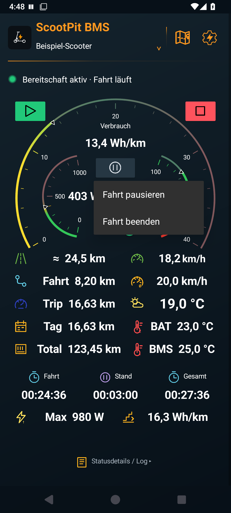
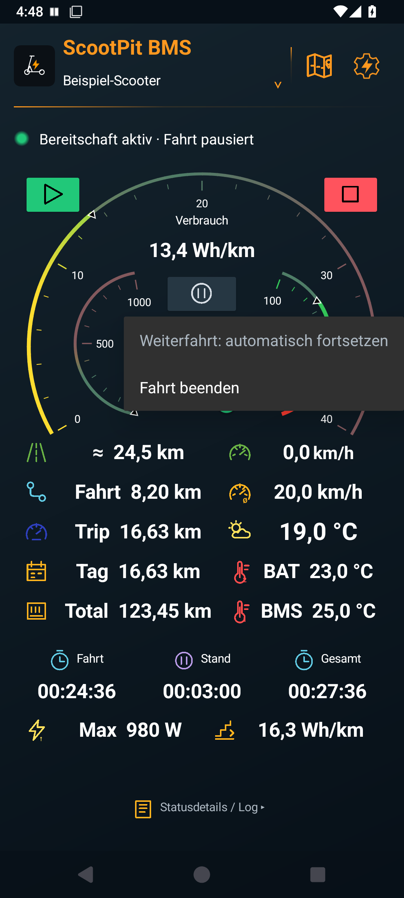
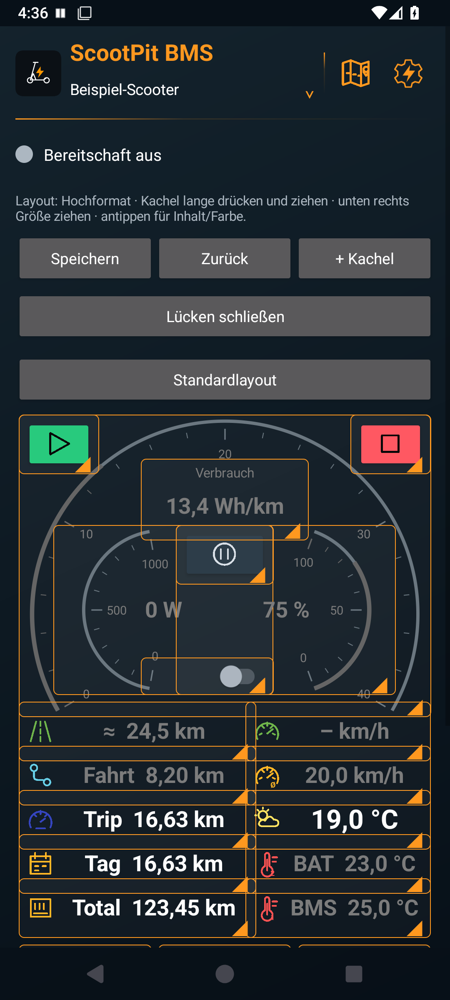
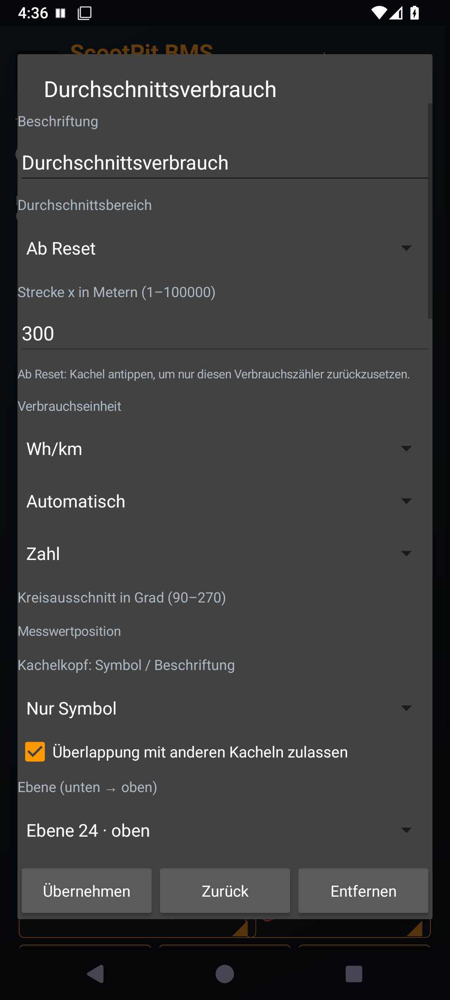
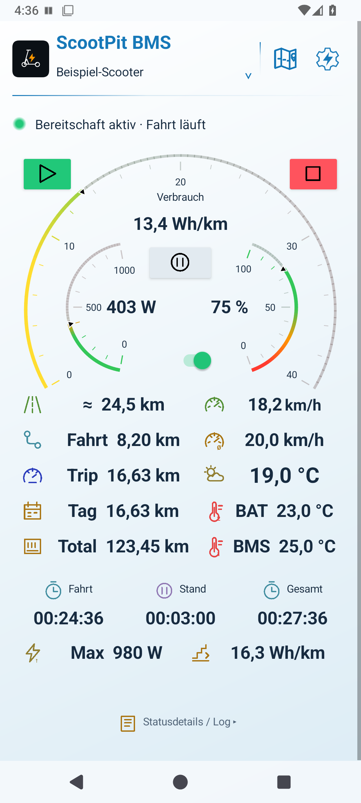
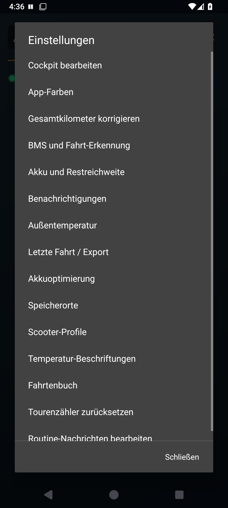

# ScootPit BMS – Bedienungsanleitung

[← Zur Übersicht](../README.md) · [Aktuelle APK herunterladen](https://github.com/Tim-Gurke/ScootPit-BMS/releases/latest)

**Stand: Version 1.6.9.** Diese Anleitung führt von der Einrichtung bis zum eigenen Cockpit. Die hier gezeigten Menü- und Cockpitbilder sind echte Aufnahmen der App im Android-Emulator. **Ihre Messwerte und das Profil „Beispiel-Scooter“ dienen der Erklärung.** Die Aufnahmen aus dem Fahrtenbuch stammen aus früheren Appversionen; ihre Funktionen sind weiterhin erreichbar.

## 1. Einrichten und die erste Fahrt aufzeichnen

1. Die signierte **ScootPit-BMS-v1.6.9.apk** aus dem Release herunterladen und auf dem Handy öffnen. Bei einem Update über die vorhandene App installieren.
2. Die angefragten Berechtigungen für **Geräte in der Nähe/Bluetooth**, **präzisen Standort** und **Benachrichtigungen** erlauben. Bluetooth und Standort am Handy einschalten.
3. Den Profilnamen im Appkopf antippen. Das Profil bei Bedarf umbenennen oder ein eigenes anlegen.
4. Über **BMS auswählen** beziehungsweise **Einstellungen → BMS und Fahrt-Erkennung → BMS auswählen → Suche starten** das eigene BMS auswählen. Die App startet ohne fest hinterlegtes Gerät. [BMS-Kompatibilität](bms.md).
5. Im Cockpit das **grüne Startdreieck** antippen. Die Statuszeile zeigt **Bereitschaft aktiv**. ScootPit sucht und verbindet das gespeicherte BMS.
6. Losfahren: Bei erfüllten Startbedingungen beginnt das Fahrtenbuch automatisch. Nach Fahrtabschluss erscheint die Aufzeichnung im **Fahrtenbuch**.

Die Standardbedingungen für den Start sind mindestens **0,30 A Stromentnahme für 1 Sekunde**. Annäherung allein startet keine Fahrt. Verbindungs- und Erkennungswerte lassen sich unter **BMS und Fahrt-Erkennung** je Scooter ändern. Eine zuverlässige GPS-Position ist für die Strecke nötig.

Für Aufzeichnungen mit gesperrtem Handy unter **Einstellungen → Akkuoptimierung** die Android-Ausnahme prüfen. Samsung kann zusätzlich eine Freigabe unter **Nie im Standby** benötigen. [Ausführliche Einrichtung](einrichtung.md).

## 2. Was finde ich wo?

*Dunkles Standardcockpit 1.6.9; Beispielwerte.*

| Stelle | Funktion |
| --- | --- |
| Profilname unter „ScootPit BMS“ | Scooter auswählen und Profile verwalten |
| Kartensymbol oben | Fahrtenbuch, Fahrtkarten und Statistiken öffnen |
| Zahnrad mit Blitz oben | Einstellungen öffnen |
| Statuszeile mit Punkt | Bereitschaft, laufende Fahrt, Pause und Hinweise zum BMS-Lastausgang |
| Grünes Startdreieck | Bereitschaft einschalten |
| Rotes Stopquadrat | Bereitschaft nach Rückfrage beenden; eine offene Fahrt wird gespeichert |
| Helles Pausezeichen zwischen den Instrumenten | Menü für die laufende Fahrt öffnen: pausieren oder beenden |
| Schalter unter den kleinen Instrumenten | BMS-Lastausgang; nur mit frischen BMS-Daten bedienbar |

**Bereitschaft und Fahrt sind zwei verschiedene Zustände:** Die Bereitschaft sucht das BMS und wartet auf den Fahrtstart. Die Fahrt ist die einzelne Aufzeichnung. **Fahrt beenden** lässt die Bereitschaft eingeschaltet; das rote Stopquadrat beendet auch die Bereitschaft.

Ohne laufende Fahrt ist der Pausenknopf deaktiviert. Sein Symbol bleibt sichtbar.

## 3. Pausieren, weiterfahren und beenden

### Eine Fahrt bewusst pausieren

1. Im Stand das **Pausezeichen** antippen.
2. **Fahrt pausieren** wählen. Die Statuszeile zeigt **Fahrt pausiert**.
3. Später weiterfahren. Sobald GPS-Fahrgeschwindigkeit und anhaltende Motorlast die Weiterfahrt bestätigen, läuft **dieselbe Fahrt automatisch weiter**. „Fortsetzen“ muss nicht ausgewählt werden.

*Das Pausezeichen öffnet die Fahrtaktionen.*

Eine manuelle Pause hält die Fahrt bis zu **12 Stunden** offen. Sie benötigt keine Wegfahrsperre. Wurde der BMS-Lastausgang währenddessen gesperrt, muss er vor der Weiterfahrt wieder freigegeben werden.

*In einer manuellen Pause erklärt das Menü die automatische Fortsetzung.*

### Automatische Pausen

| Situation | Verhalten mit den Standardwerten |
| --- | --- |
| Bestätigter Stillstand | Nach 45 Sekunden pausieren |
| Langsame Bewegung ohne Motorlast, etwa zu Fuß | Nach 15 Sekunden pausieren; Fußwege nicht als Fahrstrecke zählen |
| Ausrollen mit 0 W bei erkennbarer GPS-Fahrgeschwindigkeit | Fahrt weiter aufzeichnen |
| Bestätigte Weiterfahrt nach einer Pause | Dieselbe Fahrt automatisch fortsetzen |
| Automatische Pause dauert 10 Minuten | Fahrt rückwirkend zum Pausenbeginn abschließen |
| BMS-Verlust während automatischer Pause | Wiederverbindung standardmäßig bis 2 Minuten nach Pausenbeginn zulassen |

Diese Zeiten sind unter **Einstellungen → BMS und Fahrt-Erkennung** je Scooter einstellbar. Die 10-Minuten-Regel schließt eine **manuelle** Pause nicht vorzeitig ab. Ein ausgefallener oder ungenauer GPS-Fix allein gilt nicht als bestätigter Stillstand. [Alle Automatikdetails](hintergrund-routinen.md).

### Eine Fahrt endgültig abschließen

**Pausezeichen → Fahrt beenden → Fahrt beenden** wählen. Nach der Bestätigung wird die Aufzeichnung gespeichert. Die nächste Fahrt ist eine neue Aufzeichnung. Die Bereitschaft bleibt aktiv; die App wartet zunächst auf Stromruhe, damit der Abschluss nicht sofort rückgängig gemacht wird.

## 4. Die Werte im Standardcockpit

| Anzeige | Bedeutung und Voreinstellung in 1.6.9 |
| --- | --- |
| Großer Verbrauchsbogen und Wert darüber | Verbrauch der letzten **300 m**, Skala von **0 bis 40 Wh/km** |
| Kleines linkes Instrument | Aktuelle elektrische Entladeleistung, Skalenmaximum **1000 W** |
| Kleines rechtes Instrument | Vom BMS gemeldeter Akkustand, **0–100 %** |
| Straße und ≈ | Geschätzte Restreichweite unter Berücksichtigung der Reserve |
| Geschwindigkeit | Aktuelle GPS-Geschwindigkeit |
| Geschwindigkeit mit Ø | Durchschnittsgeschwindigkeit der **aktuellen Fahrt**, ohne Standzeiten |
| Fahrt | Strecke der aktuellen Aufzeichnung |
| Trip | Tourenzähler; läuft bis zum manuellen Zurücksetzen weiter |
| Tag | Tageskilometer; beginnt am nächsten Kalendertag neu |
| Total | Gesamtkilometer des Scooter-Profils |
| Wetter | Außentemperatur von Open-Meteo, wenn eingeschaltet |
| BAT / BMS | Editierbare Bezeichnungen der beiden BMS-Temperaturfühler; die tatsächliche Zuordnung hängt vom BMS ab |
| Fahrt / Stand / Gesamt | Fahrzeit, Standzeit und deren Summe |
| Max | Höchste während der Fahrt erfasste elektrische BMS-Leistung |
| Verbrauch unten rechts | Durchschnittsverbrauch **ab Reset**; Antippen öffnet die Reset-Rückfrage |

**„–“ bedeutet, dass ein Wert nicht verfügbar ist.** Gedimmte Werte sind nicht aktuell. Gespeicherte Kilometerzähler bleiben auch ohne Verbindung sichtbar. Ein Messwert von 0 ist ein gültiger Wert.

Die Restreichweite ist eine Schätzung. Akku und Fahrweise, Temperatur sowie die vorhandene Verbrauchshistorie beeinflussen sie. Temperaturkacheln lassen sich zum Aktualisieren antippen; die BMS-Temperatur benötigt eine aktive Verbindung.

## 5. Kacheln hinzufügen, verschieben und einstellen

1. **Zahnrad → Cockpit bearbeiten** öffnen.
2. Mit **+ Kachel** einen Wert, eine Aktion, ein Bild oder Freitext ergänzen. Neue Kacheln erscheinen nach der letzten Kachel; bei langen Cockpits nach unten scrollen.
3. Eine Kachel **lange drücken und ziehen**, um sie zu verschieben. **Unten rechts ziehen** ändert ihre Größe.
4. Die Kachel **kurz antippen**, um Beschriftung, Darstellung, Farbe und weitere Eigenschaften zu bearbeiten.
5. Im Kacheldialog **Übernehmen**, anschließend im Cockpiteditor **Speichern** wählen. Erst damit ist der gesamte Entwurf gespeichert. **Zurück** verwirft den Entwurf.

*Der Cockpiteditor zeigt das Platzierungsraster.*

Für überlappende Kacheln **Überlappung mit anderen Kacheln zulassen** einschalten. **Ebene (unten → oben)** bestimmt, welche Kachel darüber liegt. Transparente Hintergründe lassen darunterliegende Instrumente sichtbar.

Unter **Zahl / Balken / Rundinstrument** die Anzeige wählen. Rundinstrumente erlauben **90–270° Kreisausschnitt** und einen Drehwinkel. Skalenmaximum, Skalenrichtung, Farbverlauf, Messwertposition sowie Größe und Position der Einheit lassen sich je Kachel einstellen.

**Hochformat und Querformat haben getrennte Anordnungen.** Das Handy in das gewünschte Format drehen und dort bearbeiten. **Standardlayout → Zurücksetzen → Speichern** übernimmt die neue Vorgabe für dieses Format. Unveränderte Standardlayouts erhalten sie auch beim Update; persönliche Anordnungen und eigene Skalen werden erhalten.

## 6. Durchschnittswerte und Reset

Unter **Cockpit bearbeiten → + Kachel** stehen **Durchschnittsgeschwindigkeit** und **Durchschnittsverbrauch** bereit. Im Kacheldialog wählt **Durchschnittsbereich** den Bezug:

| Bereich | Berechnung |
| --- | --- |
| Letzte x Meter | Gleitendes Streckenfenster von 1 bis 100000 m |
| Aktuelle Fahrt | Werte der laufenden Fahrt |
| Ab Reset | Über mehrere Fahrten hinweg, bis diese Kachel zurückgesetzt wird |

*Bezugsbereich und Einheit werden pro Verbrauchskachel eingestellt.*

Bei **Ab Reset** im normalen Cockpit auf die Kachel tippen und die Rückfrage bestätigen. Es wird nur ihr Durchschnittszähler neu begonnen. Kilometerzähler, Fahrten und andere Durchschnittskacheln bleiben erhalten. Für einen Tourenreset die **Trip-Kachel** antippen oder **Einstellungen → Tourenzähler zurücksetzen** wählen.

Verbrauch ist wahlweise in **Wh/km** oder **% auf 10 km** darstellbar. Geschwindigkeit nutzt die Fahrzeit ohne Standzeiten. Ein noch nicht vollständig erfasstes Streckenfenster oder eine Lücke in den BMS-Energiedaten kann statt eines Durchschnitts „–“ ergeben.

## 7. Helles und dunkles Design

**Einstellungen → App-Farben → Hell · Weiß / Blau** beziehungsweise **Dunkel · Schwarz / Orange** öffnen. **Nur App-Farben** erhält eigene Kachelfarben. **Alle Kacheln** passt auch deren Farben an; transparente Kacheln bleiben transparent. Anschließend im Farbmenü **Speichern** wählen.

*Dasselbe Cockpit im hellen Design; Beispielwerte.*

## 8. Profile und Einstellungen

*Das Zahnrad öffnet die Einstellungen. Weitere Einträge sind durch Scrollen erreichbar.*

Über den **Profilnamen im Appkopf** oder **Einstellungen → Scooter-Profile** Profile anlegen, auswählen und verwalten. Ein neues Profil kann das vorhandene Design übernehmen. BMS-Zuordnung, Kilometer, Durchschnittszähler und Fahrten werden dabei nicht mitkopiert. Pro Scooter das eigene BMS auswählen.

Für manuelle Profilwechsel die Bereitschaft vorher beenden. Die automatische Scooter-Auswahl unter **BMS und Fahrt-Erkennung** kann gespeicherte Geräte selbst zuordnen; während einer Fahrt bleibt das Profil fest.

Unter **Akku und Restreichweite** Kapazität, Nennspannung, Reserve und Verbrauchsstartwert einstellen. **Außentemperatur** schaltet den Wetterabruf. **Temperatur-Beschriftungen** passt BAT/BMS an die tatsächlichen Sensoren an. [BMS-Werte und Grenzen](bms.md) · [Reichweitenschätzung](reichweite.md).

## 9. Fahrtenbuch, Karte, Statistiken und Import

1. Oben das **Kartensymbol** oder **Einstellungen → Fahrtenbuch** öffnen.
2. **7 Tage**, **30 Tage** oder **Alle** wählen. Diese Auswahl filtert die Anzeige; ältere Fahrten werden nicht gelöscht.
3. Eine Fahrt antippen und **Statistiken**, **Karte** oder **GPX und CSV teilen** wählen.
4. **Angezeigte Werte auswählen** bestimmt die Kennwerte und Diagramme. **Zeitraum auswerten / Fahrten vergleichen** fasst mehrere Fahrten zusammen.

*Vorhandene Appaufnahmen: Fahrtkarte und Einzelstatistik.*

Die Route lässt sich verschieben und zoomen; **Route** passt die ganze Strecke ein. OpenStreetMap-Hintergrundkacheln benötigen für neue Kartenausschnitte Internet. Die Aufzeichnung und ihre Statistiken bleiben lokal. Für eingeschaltete Wetterdaten erfolgt ebenfalls ein Onlineabruf; ein Benutzerkonto oder eine Cloudspeicherung der Fahrt ist nicht nötig.

Über **Einzelne Fahrt aus CSV oder GPX importieren** eine Datei hinzufügen. Für einen vollständigen Bestand **Komplettes Fahrtenbuch aus Ordner importieren** wählen und den Scooter-Fahrtenordner einschließlich Unterordnern auswählen. Importiert wird in das **aktive Profil**. Erkannte Duplikate werden übersprungen; ältere Fahrten unter **Alle** suchen. [Fahrtenbuch im Detail](fahrtenbuch.md).

## 10. Einstellungen und Fahrten sichern

**Einstellungen → Speicherorte** bietet zwei getrennte Ordner:

- **Ordner für Einstellungen wählen:** ScootPit sichert die Einstellungen in `Joyor-Cockpit-settings.json`. Die Datei enthält auch die Profile und deren Layouts. Eine vorhandene Datei über **Einstellungen aus gewähltem Ordner laden** ausdrücklich laden.
- **Ordner für Fahrtenbuch wählen:** Abgeschlossene Fahrten werden zusätzlich als GPX, CSV und JSON dort abgelegt. Ein Ordnerwechsel gilt ab der nächsten Fahrt.

Liegt bereits eine Einstellungsdatei im ausgewählten Ordner, fragt ScootPit nach **Laden** oder **Überschreiben**. Einstellungen vor dem Laden sichern, wenn der bisherige Stand erhalten bleiben soll. Das Laden erfordert beendete Bereitschaft. Nach einer Neuinstallation die Zugriffsrechte für die Ordner erneut erteilen.

Bei fehlgeschlagenen Kopien **Speichern / ausstehende Kopien erneut versuchen** wählen. Die App behält die lokalen Fahrtdateien für einen erneuten Versuch. Eine Einstellungssicherung enthält die Konfiguration; das Fahrtenbuch wird über seinen eigenen Ordner gesichert.

## 11. BMS-Lastausgang und optionale Wegfahrsperre

Der Schalter im Cockpit steuert den Entladeausgang eines kompatiblen BMS. Ein eingeschalteter Lastausgang gibt die Versorgung frei; ein ausgeschalteter blockiert die Akkuentladung. Ein Schaltvorgang benötigt frische Daten und eine Bestätigung des BMS.

Zum Sperren die Fahrt im Stillstand pausieren oder beenden und den Roller ausschalten. Die App muss zuvor einen belastbaren Standstrom des eingeschalteten Rollers gelernt haben. Der gemessene Strom muss mindestens 5 Sekunden sicher **darunter** liegen. Fehlt der Referenzwert oder ist die Messauflösung zu grob, bleibt Abschalten gesperrt. Das Lernen geschieht im Hintergrund pro Scooter und misst den Gesamtstrom, nicht den Displayverbrauch allein.

Vor dem Losfahren den Lastausgang wieder einschalten. Eine manuelle Fahrtpause und ihre automatische Fortsetzung funktionieren auch, wenn die Wegfahrsperre überhaupt nicht benutzt wurde.

## 12. Wenn etwas nicht wie erwartet aussieht

| Beobachtung | Wo weiter? |
| --- | --- |
| Kein BMS verbunden | Bluetooth, BMS-Auswahl und Berechtigungen prüfen; **BMS und Fahrt-Erkennung** öffnen |
| Messwert „–“ oder gedimmt | Auf aktuelle BMS-/GPS-Daten beziehungsweise ein vollständiges Durchschnittsfenster warten |
| Pausezeichen reagiert nicht | Das Menü ist nur während einer offenen Fahrt verfügbar; zuerst Statuszeile prüfen |
| Neue Kachel nicht im sichtbaren Bereich | Im Cockpiteditor bis hinter die letzte Kachel scrollen; Ebene und Überlappung prüfen |
| Gewünschtes Layout fehlt im Querformat | Querformat separat bearbeiten oder dort das Standardlayout übernehmen |
| Ältere Fahrt fehlt | Im Fahrtenbuch **Alle** und das richtige Scooter-Profil wählen |
| Aufzeichnung stoppt bei gesperrtem Handy | **Akkuoptimierung**, Samsung-Standbyregeln und Berechtigungen prüfen |
| BMS-Schalter gesperrt | Frische Daten, Stillstand und gelernte Standstrom-Referenz abwarten; Hinweistext beachten |

Für die Fehlersuche helfen Appversion, Handy/Android-Version, BMS-Modell und eine kurze Beschreibung des Ablaufs. Im Cockpit lässt sich **Statusdetails / Log** aufklappen.
