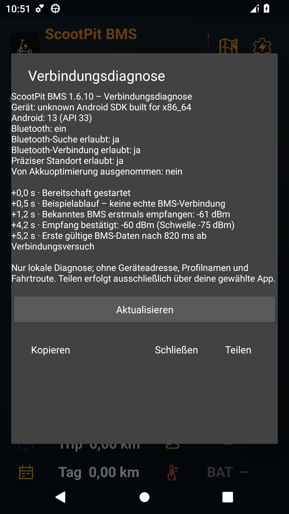

# Bluetooth-Verbindungsdiagnose

[← Übersicht](../README.md) · [Bedienungsanleitung](anleitung.md)

Ab Version **1.6.10** lässt sich unter **Einstellungen → Verbindungsdiagnose** nachvollziehen, an welcher Stelle der Verbindungsaufbau Zeit benötigt.

## Einen Verbindungsversuch prüfen

1. Bluetooth einschalten, das gespeicherte Scooter-Profil prüfen und die **Bereitschaft starten**.
2. Zum Scooter gehen und den Verbindungsversuch abwarten.
3. **Einstellungen → Verbindungsdiagnose** öffnen und **Aktualisieren** antippen.
4. Bei Bedarf über **Kopieren** oder **Teilen** den Bericht zusammen mit einer kurzen Beschreibung weitergeben: Wie lange dauerte es ungefähr, und war der Bildschirm dabei gesperrt?

Der Bericht enthält Handytyp, Android- und Appversion, Berechtigungszustand, Bluetooth-Zustand und die Android-Ausnahme von der Akkuoptimierung. Er zeigt außerdem die Empfangsschwelle, Bestätigungszeit und Suchpausen der gestarteten Bereitschaft.

Die Ereignisse verwenden die Zeit seit dem Start dieser Bereitschaft:

| Ereignis | Bedeutung |
| --- | --- |
| Suche gestartet / Suchpause | Die App sucht gespeicherte BMS oder wartet bis zum nächsten Suchfenster. |
| Bekanntes BMS erstmals empfangen | Mindestens ein Bluetooth-Signal des gespeicherten Geräts ist angekommen. |
| Empfang bestätigt | Die konfigurierten Bedingungen für einen stabilen Empfang sind erfüllt. |
| Bluetooth verbunden | Android hat die Verbindung aufgebaut; die App sucht anschließend die BMS-Datenkanäle. |
| Erste gültige BMS-Daten | Das BMS liefert eine lesbare Antwort. Auch die Dauer seit Beginn dieses Verbindungsversuchs steht dabei. |
| Android-Suchfehler / Rückmeldestatus / Zeitüberschreitung | Der numerische Fehler oder die Phase grenzt ein, wo es hängt. |

Die Standard-Erstverbindung benötigt mindestens drei ausreichend starke Messungen über **3 Sekunden**. Nach einem erfolglosen Suchfenster folgen je nach Empfang unterschiedliche Pausen. Diese Regeln helfen, einen Scooter in ausreichender Nähe zu bestätigen. Individuelle Werte lassen sich unter **BMS und Fahrt-Erkennung** ändern und gelten nach einem Neustart der Bereitschaft. Für einen Fehlerbericht die aktuellen Werte zunächst beibehalten.

*Echte Appaufnahme unter Android 13 im Emulator. Der angezeigte Ablauf ist ausdrücklich als Beispiel gekennzeichnet; es besteht keine echte BMS-Verbindung.*

## Welche Daten werden geteilt?

Das Diagnoseprotokoll hält höchstens **80 Ereignisse im Arbeitsspeicher**. Es bleibt nach dem Beenden der Bereitschaft innerhalb desselben App-Prozesses abrufbar. Ein neuer Bereitschaftsstart setzt es zurück; nach einem Prozessneustart ist es leer.

Es enthält **keine Bluetooth-Adresse, keinen Profilnamen, keine Koordinaten, Route oder Fahrtmesswerte**. Es gibt keinen automatischen Upload. **Teilen** öffnet die Android-Appauswahl; du bestimmst Empfänger und Versand. Die Übersicht im Dialog ist eine Momentaufnahme; **Aktualisieren** lädt den aktuellen Stand.

## Bluetooth automatisch einschalten?

Bluetooth muss am Handy eingeschaltet sein. Auf neueren Android-Versionen kann eine gewöhnliche App Bluetooth nicht still im Hintergrund ein- und ausschalten. Die automatische BMS-Verbindung setzt deshalb eingeschaltetes Bluetooth voraus. [Android-Plattformvorgabe](https://developer.android.com/about/versions/13/behavior-changes-13#bluetooth-adapter).
